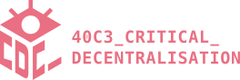

  

    
  

  

    

      
      
      
      
      
      
    

  

The _Critical Decentralisation Cluster_ (CDC) returns to the [40th Chaos
Communication Congress](https://events.ccc.de/congress/2026/infos/startpage.html)
in Hamburg (Germany) during Dec 27-30 2026. We will bring together assemblies and
projects that challenge centralized infrastructures with decentralised,
privacy-preserving and open hardware approaches. Expect talks, workshops and
lots of hallway conversations around cypherpunk futures.

Assemblies, sessions and our location will be announced here.

# sessions
Submissions open at [pretalx.riat.at](https://pretalx.riat.at/40c3/cfp)\
Deadline: December 19th 2026 23:59 CET

The CDC will have at least 2 workshop areas with public schedule.\
The main area will be equipped with a mini-stage and recording equipment for
short talks. The secondary ones will have screens and no recording.

We invite our assemblies and any other project fitting the cluster themes' to
 join in, use our spaces and share their knowledge.

# assemblies
* [RIAT](https://riat.at) - independent research institute in Vienna
* [Namecoin](https://www.namecoin.org) - decentralized tamper-resistant naming system + PKI
* [Radicle](https://radicle.xyz) - peer-to-peer code collaboration stack built on Git
* [GNU Boot](https://www.gnu.org/software/gnuboot/web) - de-shittification for your BIOS and UEFI
* Darknet PKI - public key infrastructure on top of Tor and I2P
* [Iroh](https://www.iroh.computer) - library and protocol stacks to build next-gen P2P networks
* [Sibermerdeka](https://sibermerdeka.net) - hackerspace in Kuala Lumpur
* [FunkFeuer Wien](https://funkfeuer.at) - community-run wireless mesh network and ISP
* [Replicant](https://replicant.us) - fully free Android distribution
* [Reticulum](https://reticulum.network) - resilient cryptography-based networking stack
* [BORDEL](https://bordel.wtf) - hackerspace in Prague
* [XMPP](https://xmpp.org) - the open standard for messaging and presence

We welcome other assemblies in the categories _Privacy & Anonymity_, _Enshittification_, _Cryptography_, _Open and Verifiable Hardware_, _Reverse Engineering_ and _Peer-to-Peer (P2P) networks and tools_. You can register an assembly at the [40c3 backoffice](https://events.ccc.de/congress/2026/hub/backoffice/) and request to join the Critical Decentralization Cluster as your habitat.

# contacts
* Coordination and other talk at [#cdc:dod.ngo](https://matrix.to/#/#cdc:dod.ngo) community on Matrix.
  * [#cdc-public:dod.ngo](https://matrix.to/#/%23cdc-public%3Adod.ngo)
  * [#cdc-coordination:dod.ngo](https://matrix.to/#/%23cdc-coordination%3Adod.ngo)
  * [#cdc-tickets:dod.ngo](https://matrix.to/#/%23cdc-tickets%3Adod.ngo)
  * [#cdc-watercooler:dod.ngo](https://matrix.to/#/%23cdc-watercooler%3Adod.ngo) (off-topic discussions)
* Email: c3 at RIAT's domain.

